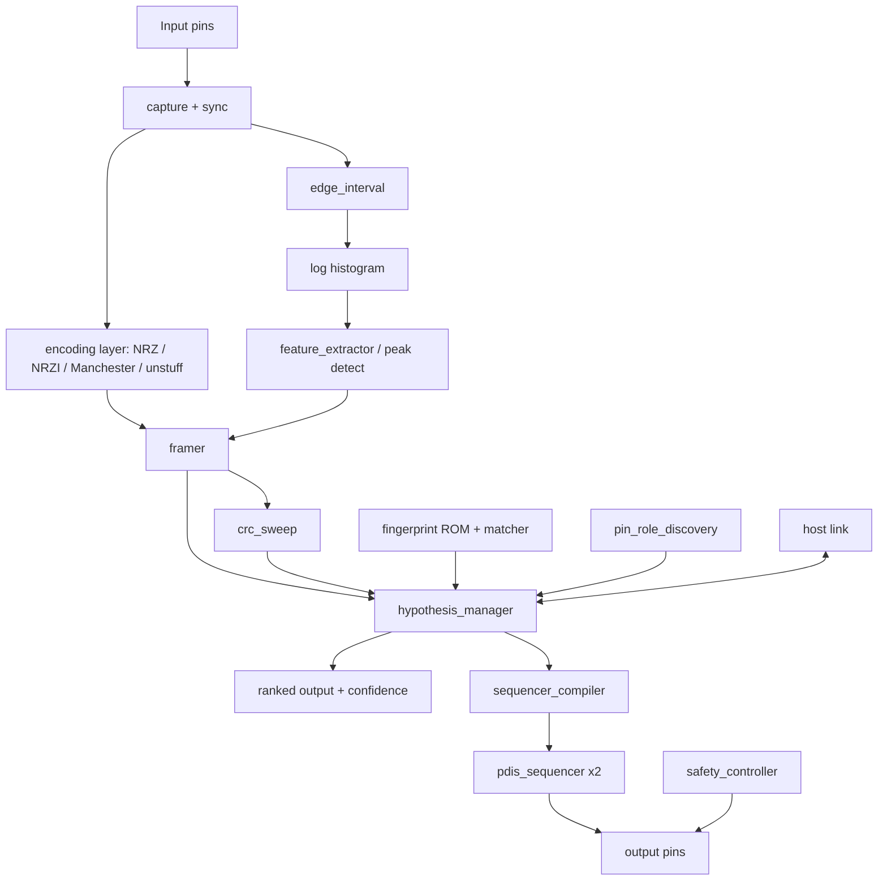

# architecture.md — Protocol Discovery Core

Status: v0.3. Cell counts are initial guesses; replace with synthesis numbers from M0 onward.

## Principle
Hardware does fast deterministic work. No general CPU. A human (via the host link) is only needed to confirm or name results.

## Block diagram

## Area budget (initial guesses; ~32K cells available)
| Block | Est. cells | Notes |
|---|---|---|
| capture + sync (all input pins) | 0.5K | double-flop |
| edge_interval + timestamp | 0.8K | shared across pins via mux |
| log histogram + edge_interval + bucket + peak (M1, measured) | 1.7K | FRAC=1 (32 bins) x 8-bit; see M1 results |
| feature_extractor / peak detect | 1.5K | |
| encoding layer | 1.5K | shared by all protocols (M8) |
| framer | 1.5K | |
| crc_sweep | 2.0K | short poly list: CRC-5/8/16 variants, CAN-15 |
| fingerprint ROM + matcher | 2.0K | sync words, switch sequences |
| hypothesis_manager | 3.0K | bounded models |
| pin_role_discovery | 2.0K | |
| pdis_sequencer x2 | 4.0K | PIO-inspired small ISA |
| safety + host link | 1.5K | |
| control FSMs + clock tree margin | 3.0K | |
| **Total** | **~27K** | ~15% headroom; real numbers will differ |

## Protocol coverage by layer
| Protocol | Needs | Notes |
|---|---|---|
| UART | timing + framing | baud, parity, stop bits |
| SPI | clock/data roles, mode | clocked; CS gives frames |
| I²C | open-drain pattern, start/stop, address ACK | |
| PS/2 | clocked + parity | easy |
| JTAG / SWD | fingerprint sequences | known reset/switch patterns |
| CAN | NRZ + stuffing + CRC-15 | needs encoding layer |
| USB low-speed | NRZI + stuffing + sync + CRC | needs encoding layer |
| 10BASE-T | Manchester + fast sampling + external receiver | stretch |

## Interfaces
- Event stream: valid/ready, word = {channel, type, timestamp, value}
- Histogram: snapshot-then-clear read port
- Model record: {rate, frame_len, encoding, bit_order, crc_id, preamble, roles, confidence}
- Sequencer: small PIO-inspired ISA (DRIVE, WAIT, SAMPLE, SHIFT, BRANCH, CRC)

## Output contract
Ranked list with confidence, never a single silent guess. Out-of-bounds input -> report "ambiguous", fall back to passive.

## Safety
Outputs tri-state by default and on fault; safety_controller overrides everything; no active probing in v1.

## Implementation language
Plain Verilog (not Hardcaml) - source of truth.

## M1 measured area (generic Yosys gates, not IHP cells; use for relative sizing only)
| FRAC (bins) | Counter bits | Total cells | Flops | Tests |
|---|---|---|---|---|
| 2 (64) | 12 | 4412 | 832 | pass |
| 2 (64) | 8 | 3128 | 572 | pass |
| 2 (64) | 6 | 2476 | 442 | pass |
| 1 (32) | 12 | 2415 | 446 | pass |
| **1 (32)** | **8** | **1738** | **314** | **pass (default)** |
| 1 (32) | 6 | 1389 | 248 | pass |

Per block at the original 64x12 setting: histogram 4253, peak_detect 138, edge_interval 109, log_bucket 95. The histogram dominates.

Caveats:
- Narrow counters saturate and can create ties in the peak search. Tests pass, but add a halve-all-on-saturation rule before trusting 6-bit counters.
- FRAC=1 gives ~41% bucket width; refine the baud from the minimum interval inside the peak bucket (planned for M2).
- Replace these numbers with IHP post-synthesis cell counts at M0/M7.

## M2 results: UART auto-baud + frame inference (hardened, sim passing)
Pipeline: histogram peak bucket -> three refinement passes (bucket mean, then two windowed means of 16 intervals within +-25% of the estimate) -> subharmonic check (halve T if intervals near T/2 are at least half as common as near T) -> framer reads 10 slots, each sampled at 25/50/75% of the bit with majority vote -> 6 hypotheses (7N1, 7E1, 7O1, 8N1, 8E1, 8O1) scored over 32 frames, up to 4 disagreeing frames tolerated.

Area (generic Yosys gates): m2_top 3838 cells (524 flops); uart_framer 878 cells. That is about 12% of the 32K budget, before SPI/I2C, fingerprint, pin-role and sequencer blocks.

Hardening history (found by the noise testbench, fixed in RTL):
| Problem found | Symptom | Fix |
|---|---|---|
| Min-interval baud estimate | T underestimated under jitter (96 for 100) | Mean of 16 intervals |
| Bucket-truncated mean | T biased +5% at a bucket edge, mis-sampling | Windowed mean around running estimate |
| Peak on 2T bucket | T=199 reported for T=100 | Subharmonic check halves T |
| Strict all-frames match | One corrupted frame flipped the result | Tolerance of 4 of 32 frames |
| Single-point sampling | Glitch at sample instant flips a bit | 3-sample majority vote |

Test results (20 seeds per case unless noted):
- Clean regression: 7/7 cases pass
- Noise suite (6 seeds): 36/36
- Stress (jitter up to +-10% per edge, glitches up to 1/2000 per cycle): 140/140
- Limits: breaks at jitter +-20% (14/20), glitch density 1/1000 (18/20), 1/500 (11/20), 1/200 (0/20), and at 12 cycles per bit with jitter (10/20)
- Every failure in the limits run reported `fail=1`; none returned a confident wrong answer

Known limits:
- Below about 16 clock cycles per bit, rounding error in T accumulates over the frame; next fix is edge resynchronization inside the frame
- 2 stop bits cannot be told apart from 1 stop + idle without back-to-back frames
- 7E1 passes as 8O1 and 7N1 as 8N1 at bit level; the shortest consistent frame wins
- Frames must be separated by >= 4 bit-times of idle plus the 10-slot window; continuous back-to-back streams are not handled yet
- Assumes idle-high and LSB-first
- Test signals are simulated: jitter and glitches are synthetic, not measured from real devices

## M8: Encoding Layer Integration
The encoding_layer module (encoding_layer.v) is now integrated into m3_top and m6_top:
- Applied to SPI data line (pin 0 / pins_in[0]) only
- I2C uses raw signals directly (no encoding needed)
- Supports: NRZ (default), NRZI, Manchester, Bit-stuffing (CAN/USB)
- CRC sweep module available for frame validation
- Manchester decoder for 10BASE-T (stretch)

Encoding layer modes:
| Mode | Value | Use case |
|------|-------|----------|
| NRZ | 2'd0 | Default, direct bit mapping |
| NRZI | 2'd1 | USB Low-speed |
| Manchester | 2'd2 | 10BASE-T Ethernet |
| Stuffing | 2'd3 | CAN, USB bit stuffing |
